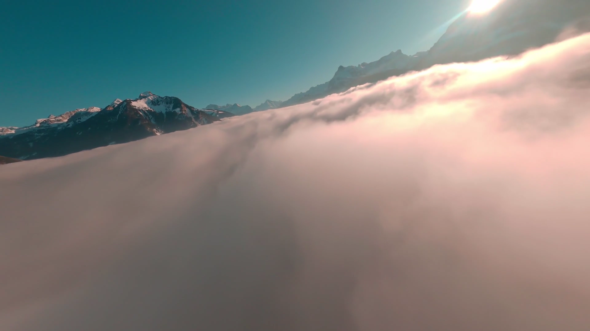
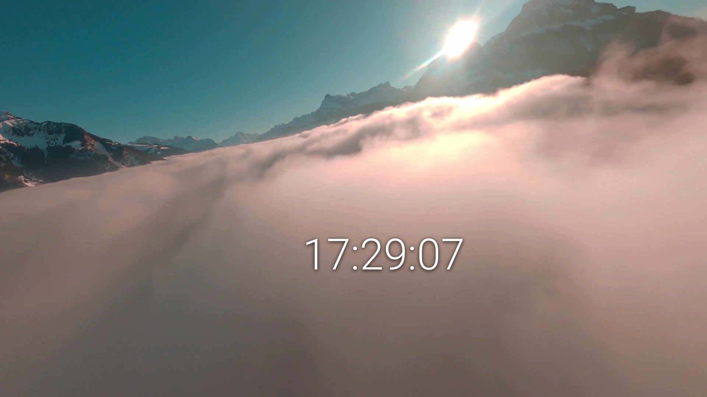
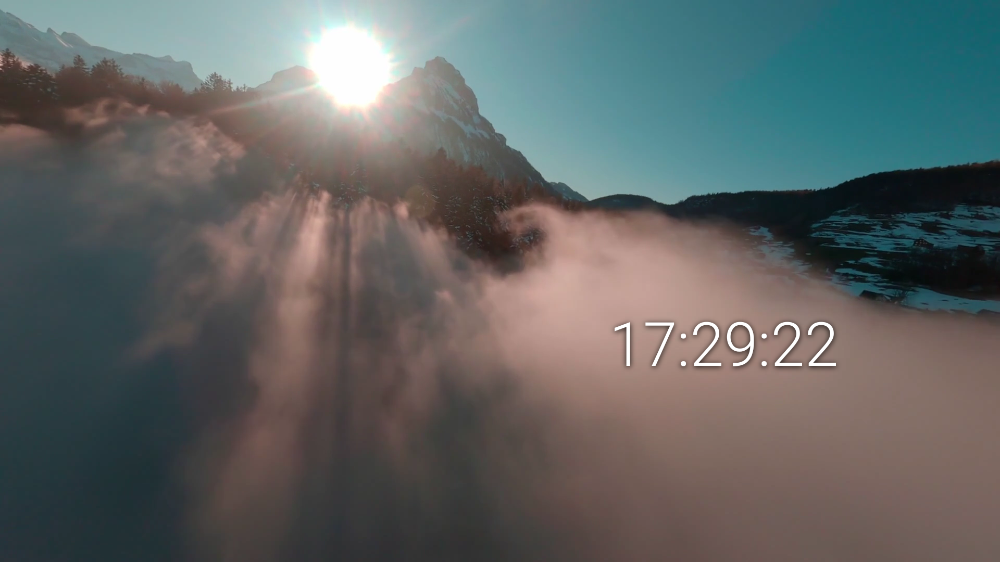
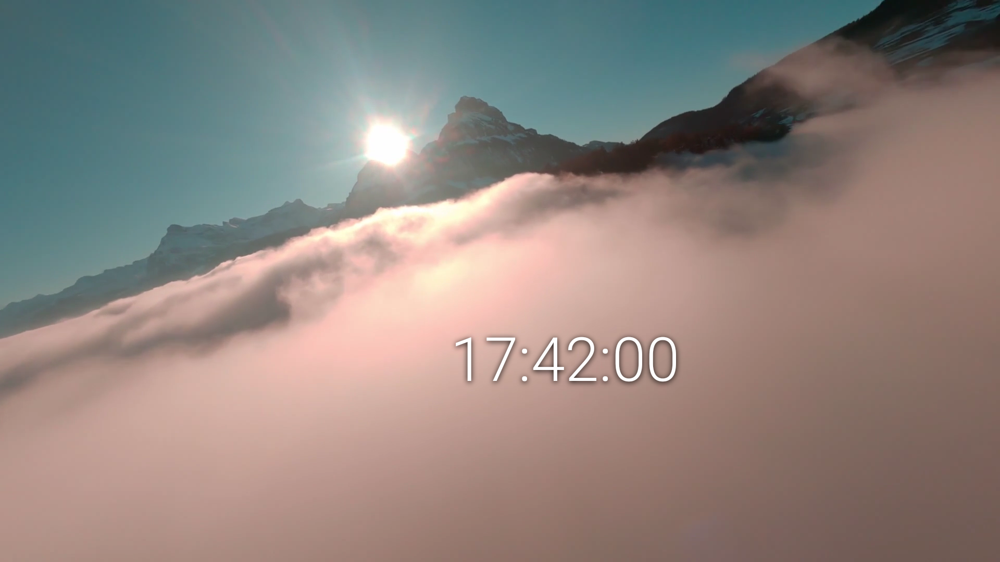
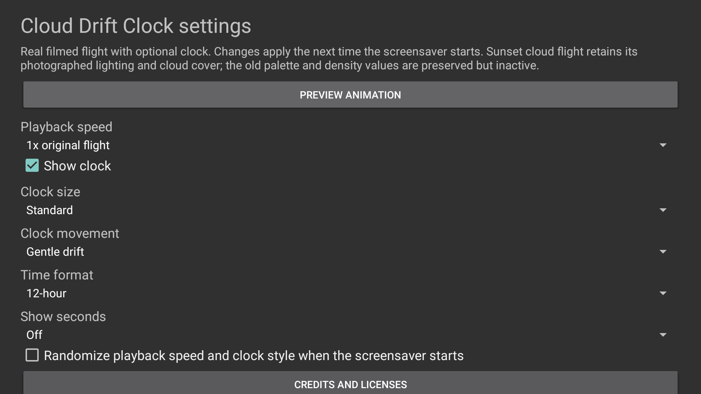
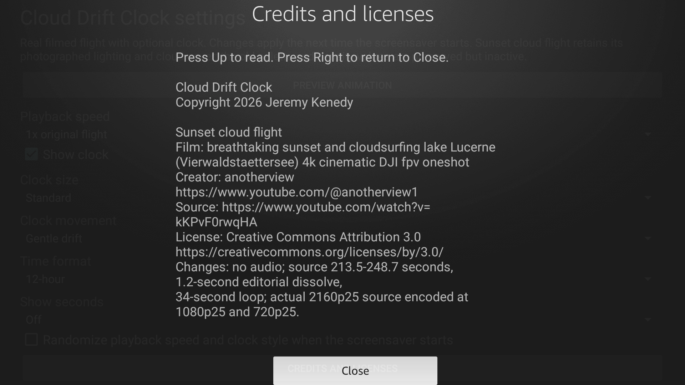
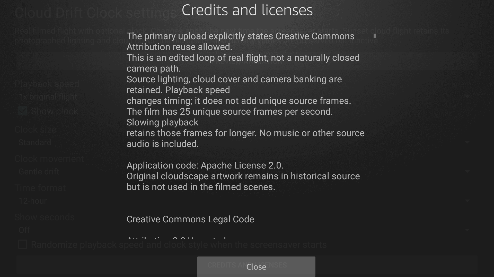

# Current native screenshots

These version 2 captures are actual physical Fire TV AFTALMO output, API 28, 1920 by 1080, from the filmed production candidate. They contain no private account or device configuration data. The old photograph-renderer screenshot does not represent version 2.

<table>
<tr><th>Clock Off</th><th>Clock On</th><th>Drift</th></tr>
<tr><td></td><td></td><td></td></tr>
<tr><th>Dream Off</th><th>Dream On</th><th>Settings</th></tr>
<tr><td></td><td></td><td></td></tr>
<tr><th>Credits</th><th>Licenses</th><th></th></tr>
<tr><td></td><td></td><td></td></tr>
</table>

[Capture provenance](../art/screenshots/sources-v2.json) records original file hashes and the tested candidate. The in-app poster uses the exact word-free native Preview capture. Final code5 signed update, Credits scrolling and actual Close button, exact-APK clock-off Preview and Back passed. Rendering and clock images from code4 retain their original provenance; renderer/clock logic and all media are unchanged in code5. Screenshots alone do not establish frame pacing, loop quality or compatibility with other TVs.
